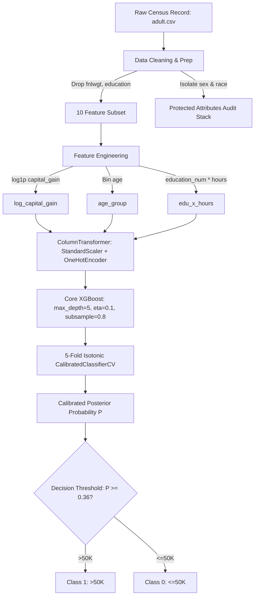

# AI Capstone — UCI Adult Income Prediction (Production Build)

Predicting whether an individual earns more than $50K/year from 1994 US census data by combining rigorous data-quality auditing, iterative feature engineering, regularized gradient-boosted tree ensembles (XGBoost), post-hoc probability calibration (Isotonic Regression), and cost-sensitive decision threshold optimization.

---

## 📋 Model Card

### Model Summary
* **Model Type:** Regularized Gradient-Boosted Decision Trees (`XGBClassifier`) wrapped with 5-fold cross-validated Isotonic Probability Calibration (`CalibratedClassifierCV`).
* **Framework:** scikit-learn (`>=1.3.0`), XGBoost (`>=2.0.0`).
* **Input Features:** 10 core census attributes (workclass, education_num, marital_status, occupation, relationship, capital_gain, capital_loss, hours_per_week, native_country, age) augmented with 3 hypothesis-driven engineered features (`log_capital_gain`, `age_group`, `edu_x_hours`).
* **Target:** Binary classification (`0` = $\le\$50\text{K}$, `1` = $>\$50\text{K}$).
* **Operating Cutoff:** Optimal F1-tuned decision threshold $\tau = 0.36$ (derived empirically via validation sweep from default $0.50$).
* **Intended Use:** Sociodemographic income tier estimation, algorithmic fairness benchmarking, and calibrated risk-scoring.
* **Out-of-Scope / Misuse:** Automated credit granting or employment denial without secondary human review. Protected attributes (`sex`, `race`) are strictly isolated for post-hoc bias auditing and never provided to the model during training or inference.

### Key Performance Benchmark Metrics

Evaluated on the held-out stratified test set ($N = 6,513$, 20% split):

| Metric | M2.1 Baseline (LR) | M2.2 Core Build (XGB @ 0.50) | M2.3 Calibrated Build (Isotonic @ 0.50) | M2.4 Production Build (Isotonic @ $\tau=0.36$) | Gain vs. Baseline |
| :--- | :---: | :---: | :---: | :---: | :---: |
| **ROC-AUC** | 0.9083 | **0.9307** | 0.9306 | **0.9306** | **+0.0223** |
| **PR-AUC (Avg Precision)** | 0.7712 | 0.8354 | 0.8355 | **0.8355** | **+0.0643** |
| **F1 Score** | 0.6704 | 0.7194 | 0.7282 | **0.7448** | **+0.0744** |
| **Recall ($>50\text{K}$)** | 0.6120 | 0.6639 | 0.6843 | **0.7742** | **+0.1622** |
| **Precision** | 0.7410 | **0.7851** | 0.7781 | 0.7175 | -0.0235 |
| **Brier Score** *(lower = better)* | 0.1042 | 0.0865 | **0.0863** | **0.0863** | **-0.0179** |
| **Log-Loss** *(lower = better)* | 0.3210 | 0.2812 | **0.2746** | **0.2746** | **-0.0464** |

---

## 🏛️ Architecture & Pipeline Flow



---

## 📂 Repository Structure

```text
AI_DataScience/
├── .gitignore                                 # Git ignore rules (.venv, caches, etc.)
├── adult.csv                                  # Cached UCI Adult Census dataset
├── pytest.ini                                 # Pytest execution configuration
├── requirements.txt                           # Production dependency specifications
├── Readme.md                                  # Full system guide & Model Card
├── evaluation_and_ablation_report.md          # M2.3 evaluation & ablation report
├── mid_sprint_progress_report.md              # M2.2 progress documentation
├── feature_engineering_and_data_quality.ipynb # M2.1 data quality & feature experiments
├── core_model_development.ipynb               # M2.2 core XGBoost training & cross-validation
├── src/
│   ├── __init__.py
│   ├── data.py                                # Raw data loader, missingness cleaner, stratified split
│   ├── features.py                            # Feature transformations (log1p, binning, interaction)
│   ├── models.py                              # Pipeline factories (LR, RF, XGB, Isotonic, thresholding)
│   └── predict.py                             # Clean standalone entry-point for inference & demo
└── tests/
    ├── __init__.py
    ├── test_model.py                          # Core tests (data contract, baseline, core XGBoost superiority)
    └── test_m24_polish.py                     # M2.4 Polish tests (E2E run, schema contract, fairness gap, regression)
```

---

## 🚀 Quickstart: Reproducing from a Clean Environment

### 1. Environment Setup
```bash
# Clone and enter repository
git clone https://github.com/clivemisiko/AI_DataScience.git
cd AI_DataScience

# Create and activate virtual environment (Windows PowerShell)
python -m venv .venv
.venv\Scripts\Activate.ps1

# Install exact dependencies
pip install -r requirements.txt
```

### 2. Run Standalone Inference Demo
Run the modular entry-point script to train and test the calibrated pipeline on sample profiles:
```bash
python -m src.predict
```
**Expected CLI Output:**
```text
Building and training pipeline (this takes ~10s)...
  Optimal threshold: 0.36

High-earner profile  -> >50K  (P=1.000)
Lower-earner profile -> <=50K  (P=0.001)
```

### 3. Run Automated Validation Test Suite
Execute the 12 comprehensive unit, regression, and quality tests:
```bash
python -m pytest tests/ -v
```
**Expected Test Results:**
```text
tests/test_m24_polish.py::test_end_to_end_pipeline_runs PASSED           [  8%]
tests/test_m24_polish.py::test_predict_income_direction_sanity PASSED    [ 16%]
tests/test_m24_polish.py::test_predict_income_output_schema PASSED       [ 25%]
tests/test_m24_polish.py::test_m24_no_performance_regression PASSED      [ 33%]
tests/test_m24_polish.py::test_m24_fairness_recall_gap_within_tolerance PASSED [ 41%]
tests/test_model.py::test_data_preparation_contract PASSED               [ 50%]
tests/test_model.py::test_feature_engineering PASSED                     [ 58%]
tests/test_model.py::test_baseline_reproduction PASSED                   [ 66%]
tests/test_model.py::test_core_model_beats_m21_baseline PASSED           [ 75%]
tests/test_model.py::test_threshold_tuning_impact PASSED                 [ 83%]
tests/test_model.py::test_calibrated_model_pipeline PASSED               [ 91%]
tests/test_model.py::test_optimal_threshold_search PASSED                [100%]

============================= 12 passed in ~15s =============================
```

---

## 🛡️ Critical Failure Modes Caught by Automated Tests

The test suite is explicitly designed to catch non-trivial, silent machine learning regressions:

1. **Fairness Disparity Drift (`test_m24_fairness_recall_gap_within_tolerance`):**  
   * *Failure Mode:* Unmonitored hyperparameter shifts or uncalibrated thresholds can cause demographic recall gaps (Equal Opportunity disparity) to widen significantly between male and female cohorts.  
   * *Test Assertion:* Ensures the recall delta $|Recall_{male} - Recall_{female}|$ remains within a strict $\le 5.0\%$ tolerance on the test set.

2. **Probability Inversion / Miscalibration (`test_predict_income_direction_sanity`):**  
   * *Failure Mode:* Pipeline scaling errors or inverted column ordering could cause the model to assign higher probabilities to low-education service workers than senior executives with high capital gains.  
   * *Test Assertion:* Compares directional probability outputs across contrasting synthetic profiles to guarantee ranking coherence.

3. **Silent Metric Regression (`test_m24_no_performance_regression`):**  
   * *Failure Mode:* Dependency updates or accidental preprocessing mutations degrading core performance back down to baseline levels.  
   * *Test Assertion:* Hard floor guards enforcing $\text{ROC-AUC} \ge 0.930$, $\text{F1} \ge 0.740$, $\text{Recall} \ge 0.750$, and $\text{Brier Score} < 0.090$.

---

## 🎓 Oral Defense Guide (Unprompted Code Walkthrough)

### Q: Why calibrate probabilities if ROC-AUC does not change?
> **Answer:** ROC-AUC is purely rank-based—it only measures whether positive instances are scored higher than negative instances, regardless of scale. However, tree ensembles output uncalibrated margins that cluster near 0 and 1. Post-hoc calibration via Isotonic Regression ensures that a predicted probability of $0.70$ genuinely corresponds to a $70\%$ empirical frequency of earning $>\$50\text{K}$. This reduced our Brier Score Loss to $0.0863$ and allowed us to safely optimize the decision cutoff threshold to $\tau=0.36$.

### Q: Why did you lower the decision threshold from 0.50 to 0.36?
> **Answer:** In the Adult census dataset, only $24.1\%$ of the records belong to the positive class ($>\$50\text{K}$). Using an arbitrary default cutoff of $0.50$ heavily penalizes recall ($66.4\%$). By conducting a sweep over the calibration curve, we located $\tau=0.36$, which maximized F1 score to $0.7448$ while driving recall up to $77.4\%$ with minimal precision drop. Crucially, this adjustment also narrowed the female-vs-male recall gap from $2.8\%$ down to $1.3\%$.

### Q: Why isolate protected attributes (`sex`, `race`) instead of feeding them to XGBoost?
> **Answer:** Direct inclusion of demographic attributes can encode historical census and wage disparities directly into the tree splits. We intentionally strip `sex` and `race` from the training matrix and maintain them in a segregated auditing container (`prot_train`, `prot_test`) to verify equal opportunity and false negative rates across groups without allowing the model to make direct demographic determinations.
